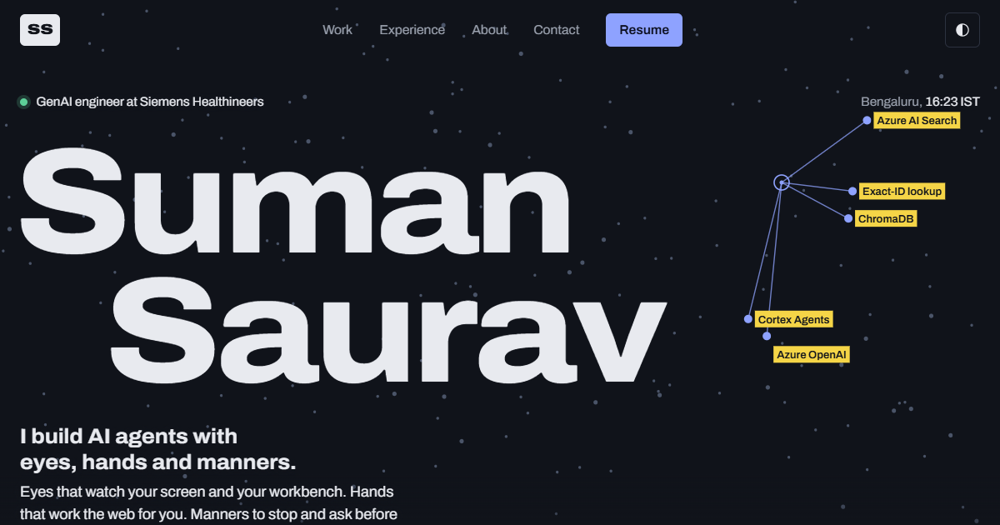

<div align="center">

# Suman Saurav — Portfolio

**Generative AI engineer building AI agents with eyes, hands and manners.**

[](https://sumansaurav.vercel.app)
[](https://vercel.com)


[](https://sumansaurav.vercel.app)

</div>

## Overview

This is the source of my personal website. It's a single, hand-built page in plain HTML, CSS and JavaScript. There are no frameworks, no build step and no trackers.

The design follows the idea behind most of my work: **AI should show its evidence**. The hero is an interactive embedding space. Your cursor acts as a query vector, and its nearest skills light up the way top-k retrieval works. Benchmark numbers on the page link straight to their sources.

## Highlights

- **Interactive embedding-space hero.** A canvas of skill "points" grouped into topic clusters. The cursor (or your finger on touch screens) is the query, and the nearest neighbours (5 on desktop, 3 on phones) connect with retrieval lines and highlighted labels. When idle, the query wanders on its own.
- **Variable-font name.** The name "boots up" from narrow and light to wide and heavy on load, using Archivo's width and weight axes.
- **Bento project grid.** Each tile has a data visual (benchmark bars, a checklist, a call graph, embedding vectors), a pointer spotlight, and a full case study in an animated `<dialog>`.
- **Cited metrics.** Numbers carry citation markers that link to the original benchmark report.
- **Light and dark themes.** The site follows the system setting and remembers your choice.
- **Built to be shared.** Open Graph and Twitter cards, a canonical URL, and `Person` structured data (JSON-LD) for search engines.

## Tech

| Area | Choice |
|---|---|
| Markup | Semantic HTML5: `<dialog>`, `<figure>`, `<dl>`, landmarks |
| Styling | Modern CSS: custom properties, `@property`, `color-mix()`, `:has()`, scroll-driven animations (progressive enhancement) |
| Interaction | Vanilla JavaScript (Canvas 2D, `IntersectionObserver`, `ResizeObserver`) |
| Typography | [Archivo](https://fonts.google.com/specimen/Archivo) variable font (width 62–125, weight 100–900) |
| Hosting | [Vercel](https://vercel.com). Every push to `main` deploys to production |

## Accessibility and performance

- Respects `prefers-reduced-motion`: animations stop and the canvas draws a still frame.
- Visible keyboard focus, a skip link, labelled controls, and alt text for every image.
- The canvas pauses when it's off screen or the tab is hidden.
- All content, including every case study, is real HTML text in the page source, so search engines and AI screening tools can read it.
- Small assets: the profile photo is a 22 KB WebP, and there are no runtime dependencies.

## Project structure

```
.
├── index.html            # All page content, metadata and structured data
├── styles.css            # Design tokens (light/dark), layout and components
├── script.js             # Hero canvas, theme toggle, case-study dialogs, small enhancements
└── assets/
    ├── profile.webp      # Portrait
    ├── og-image.png      # 1200×630 link-preview image
    └── Suman_Saurav_Resume.pdf
```

## Run locally

Any static file server works. For example:

```bash
python -m http.server 8080
```

Then open <http://localhost:8080>.

## Deployment

The site is deployed on Vercel with no build step (framework preset **Other**, no build command, project root as the output). Every push to `main` deploys to <https://sumansaurav.vercel.app>.

## Contact

- **Email:** [sumansauravsu9@gmail.com](mailto:sumansauravsu9@gmail.com)
- **LinkedIn:** [suman-saurav-a98394224](https://www.linkedin.com/in/suman-saurav-a98394224/)
- **GitHub:** [@sumansauravsu6](https://github.com/sumansauravsu6)

---

© 2026 Suman Saurav. The code is shared for reference. The written content, photos and resume are personal and may not be reused.
